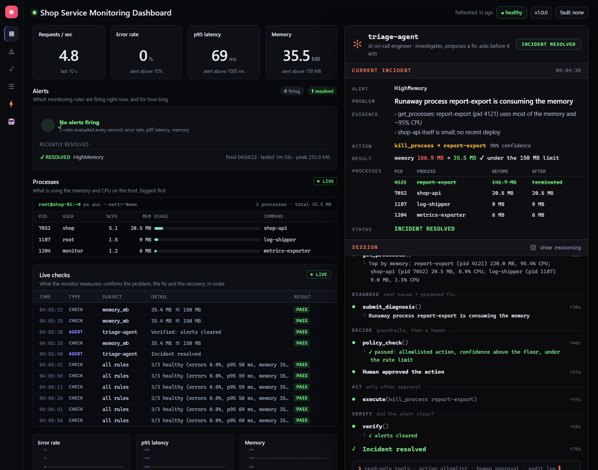
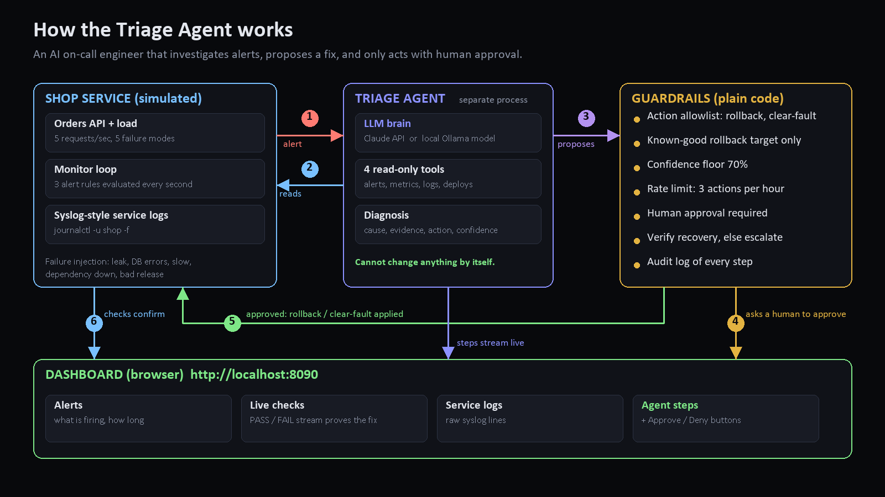

# Triage Agent: an AI on-call engineer for monitoring

[](https://github.com/SuyogKulkarni0/agentic-ai-monitoring-tool/actions/workflows/tests.yml)


When an alert fires, an AI agent investigates it like an on-call engineer: it reads the metrics, logs and recent deploys, works out the likely cause, proposes a fix, and **waits for a human to approve** before changing anything. It then proves the fix worked with a live before/after check.



## Try it in 60 seconds

Needs Python 3.9+ and nothing else (standard library only). On macOS/Linux use `python3`.

```bash
git clone https://github.com/SuyogKulkarni0/agentic-ai-monitoring-tool.git
cd agentic-ai-monitoring-tool
python run_demo.py              # starts the service and opens the dashboard
python run_demo.py --agent      # ...and starts the AI agent too
```

For `--agent` you need a brain, either of:
- the Claude API: set `ANTHROPIC_API_KEY` (and `pip install anthropic`), or
- a free local model: install [Ollama](https://ollama.com) and run `ollama pull qwen2.5:7b`.

Then click **deploy v1.1.0 (bad)** under *Failure injection*. The alert fires, the agent investigates, and an **Approve / Deny** box appears. Approve it and watch the *Live checks* panel go from FAIL to PASS.

## How it works



1. The service's **monitor loop** evaluates alert rules every second; an alert fires.
2. The **agent** wakes up and uses an LLM to decide what to check.
3. It can only call five **read-only tools**: alerts, metrics, logs, deploy history and the process list (like `ps aux --sort=-%mem`). It ends with a structured diagnosis: root cause, evidence, proposed action, confidence.
4. **Guardrails** (plain code, not the model) decide whether the proposal may run, then ask a human to approve in the browser.
5. If approved, the action is applied (roll back, or clear the fault).
6. The agent **verifies** recovery and the *Live checks* stream shows the metric going back under its limit. Every step is in an audit log.

## What each part of the dashboard is for

| Section | Looks like | Purpose |
|---|---|---|
| Metric tiles and charts | Grafana-style widgets | Health at a glance, with the alert thresholds drawn in |
| **Alerts** | Alertmanager-style cards | Which rules are firing, for how long, plus recently resolved |
| **Live checks** | A PASS/FAIL measurement stream | Confirms the problem, the fix and the recovery, in order |
| **Service logs** | Real syslog (`journalctl -u shop -f`) | What the application itself writes |
| **Processes** | A `ps`-style table with memory bars | Which process is using the memory and CPU |
| **Ask (chat box)** | Type or click: services, database, memory, CPU, alerts | Instant read-only answers from live data. No model call, so it is fast, and it cannot change anything |
| **Failure injection** | Terminal-style buttons | Break the service on purpose, or put it back |
| **Triage Agent** | Separate panel with step cards | What the AI is doing, the incident summary, and the Approve / Deny buttons |

The *Live checks* stream is the evidence. A real run looks like this:

```
CHANGE  deploy          v1.1.0 deployed (release with checkout changes)
ALERT   HighErrorRate   5xx error rate 18.7% exceeds 10%                FIRING
CHECK   error_rate_pct  47.6% > 10%                                      FAIL
AGENT   operator        approved the action                              APPROVED
CHANGE  deploy          v1.0.0 deployed (automated rollback)
ACTION  triage-agent    rollback to v1.0.0 applied                       DONE
ALERT   HighErrorRate   5xx error rate back to 9.7% after 79s            RESOLVED
CHECK   error_rate_pct  8.3% <= 10%                                      PASS
```

## Failure scenarios

| Button | What happens | Alert that fires |
|---|---|---|
| memory-leak | Each request retains 1 MB inside `shop-api` | HighMemory (fix: restart the service) |
| runaway-process | A separate `report-export` job eats memory and CPU | HighMemory (fix: kill that process; the before/after process table is the proof) |
| db-errors | About half of requests fail: "connection pool exhausted" | HighErrorRate |
| slow-responses | 1.2-2.5 s per request | HighLatencyP95 |
| dependency-down | Every order returns 502, "inventory unreachable" | HighErrorRate |
| deploy v1.1.0 (bad) | A bug in checkout: about 40% of requests fail with a `KeyError` | HighErrorRate |

## Guardrails

The model only proposes. `agent/guardrails.py` decides whether anything runs.

| Guardrail | Rule |
|---|---|
| Allowlist | Only `rollback` (to a known-good version), `clear_fault`, `kill_process` (the named runaway job only, never `shop-api`) and `restart_service` (the shop only). Anything else escalates to a human |
| Known-good target | Rollback only to versions in `KNOWN_GOOD_VERSIONS` |
| Confidence floor | Below 70% the agent escalates and does not even ask for approval |
| Rate limit | At most 3 executed actions per hour |
| Human approval | Explicit Approve required; a timeout or closed page counts as No |
| Verification | After acting, alerts are re-checked; the "after" numbers are taken once the metrics settle. If alerts persist it escalates |
| Audit log | Every step goes to `data/audit.jsonl` |

## Results (qwen2.5:7b, CPU-only laptop, 15 runs)

`eval/run_eval.py` injects each failure three times, runs the agent read-only, and scores the diagnosis against the known cause.

| Scenario | Reached diagnosis | Root cause right | Action OK | Fully correct | Avg seconds |
|---|---|---|---|---|---|
| Bad release (v1.1.0) | 3/3 | 3/3 | 3/3 | 3/3 | 162 |
| Memory leak | 3/3 | 3/3 | 0/3 | 0/3 | 161 |
| Database errors | 3/3 | 3/3 | 0/3 | 0/3 | 121 |
| Slow responses | 3/3 | 0/3 | 1/3 | 0/3 | 159 |
| Dependency down | 3/3 | 3/3 | 0/3 | 0/3 | 170 |
| **Overall** | **15/15** | **12/15 (80%)** | **4/15 (27%)** | **3/15 (20%)** | **155** |

What this shows:
- A small local model usually finds the cause (80%) but often picks the wrong fix. It proposed a rollback when no bad release had shipped, and `restart` for DB errors.
- It missed the slow-response incident, blaming a vague "configuration change" log line.
- Of the 11 wrong-action proposals, 5 were blocked by policy. The other 6 were rollbacks to the already-running v1.0.0, which policy allows, so they would have reached the human approval step. Human approval is the last line of defence, which is why it is mandatory.
- Limits: one model, three runs per scenario, keyword scoring, a simulated service. This is not a general benchmark. Scoring counts `restart` for DB errors as wrong because it is not allowlisted.

Ideas to improve it: a stronger model, a prompt that says rollback only applies when a deploy preceded the incident, and tool outputs that include the current vs. previous version.

## Design decisions worth knowing

- **The model proposes, code decides.** Safety does not depend on the model behaving well.
- **Reading and acting are separate.** The investigating agent has no write tools; a test enforces it.
- **Escalation is the default.** Low confidence, an unknown action, the rate limit or a failed verification all hand off to a human.
- **Model output is untrusted.** The dashboard escapes everything the agent writes; the agent accepts a text-only diagnosis only if it passes the same validation as a tool call.
- **Eval hygiene.** Early runs were wrong for the wrong reasons: stale logs from a previous incident leaked in as evidence, and one log line named the injected fault. Reset now clears logs and history, and the config-change line is deliberately vague.
- **Verification waits for calm.** Alerts clear as soon as a metric dips under its limit, but a rolling window still holds some of the failure, so the "after" reading waits until the numbers settle.

## Project layout

```
run_demo.py            one-command launcher
demo_app/              simulated shop service, monitor loop, alert rules, dashboard
agent/agent.py         the investigation loop and tools
agent/guardrails.py    policy, approval, verification, audit log
agent/ollama_client.py local-model backend (same interface as the Claude SDK)
agent/reporter.py      streams the agent's steps to the dashboard
eval/                  eval harness, results and scoring tests
docs/                  diagrams and screenshots
```

## Agent options

```bash
python agent/agent.py --watch --browser-approval   # the demo mode (what run_demo.py --agent runs)
python agent/agent.py                              # one investigation, approve in the terminal
python agent/agent.py --dry-run                    # full approval flow, but never executes
python agent/agent.py --diagnose-only              # diagnosis only
python agent/agent.py --backend ollama             # force the local model (AGENT_MODEL to change it)
python eval/run_eval.py --runs 3 --backend ollama  # the eval (resumable with --resume)
```

## Tests

```bash
cd agent && python -m unittest -v    # agent loop, guardrails, live view
cd eval  && python -m unittest -v    # scoring
```

Both run in CI on every push. The tests use a scripted fake model, so they need no API key or running service.

## Limits and what production would need

This is a simulated service and a demo, not a product. For real use you would replace the simulated service with Prometheus and Alertmanager (the agent would receive webhooks), keep secrets in a vault, restrict the approval button with real authentication, and watch the cost and latency of each investigation (a CPU-only local model took about 2.5 minutes per incident).
